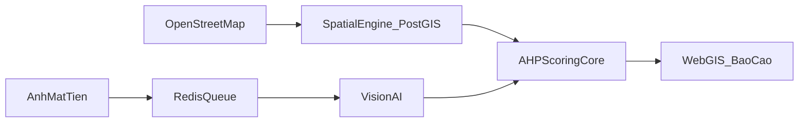

# Tổng quan dự án

Nền tảng web hỗ trợ đánh giá mức độ phù hợp của địa điểm kinh doanh tại nội thành Hà Nội. Hệ thống kết hợp phân tích không gian đa chiều (GIS) với trí tuệ nhân tạo đa phương thức để chấm điểm, so sánh và tư vấn mặt bằng theo từng ngành hàng.

Tài liệu này mô tả đề tài ở mức ổn định. Tiến độ triển khai và trạng thái duyệt nằm ở [TIEN-DO.md](TIEN-DO.md).

## Tên đề tài

**Tiếng Việt:** Xây dựng hệ thống hỗ trợ đánh giá mức độ phù hợp địa điểm kinh doanh dựa trên phân tích dữ liệu không gian đa chiều (GIS) kết hợp trí tuệ nhân tạo đa phương thức.

**Tiếng Anh:** Development of a Commercial Location Suitability Decision Support System Based on Multi-dimensional Spatial Analysis (GIS) and Multimodal Artificial Intelligence.

## Bài toán

Tại các thành phố lớn như Hà Nội, chọn mặt bằng (cửa hàng bán lẻ, dịch vụ ăn uống, nhà thuốc) quyết định sự sống còn của mô hình kinh doanh vừa và nhỏ. Khảo sát hiện nay phần lớn dựa trên kinh nghiệm cảm tính, thiếu số liệu về mật độ dân cư, hệ sinh thái tiện ích xung quanh, áp lực cạnh tranh trực tiếp và khả năng tiếp cận giao thông.

Bản đồ số thông thường chỉ hiển thị vị trí. Chúng chưa phân tích không gian theo từng loại hình kinh doanh, và cũng không phản ánh yếu tố vật lý tại thực địa: độ rộng vỉa hè, khả năng đỗ xe, vật cản che tầm nhìn mặt tiền.

Đề tài xây dựng một hệ hỗ trợ ra quyết định (Decision Support System). GIS xử lý dữ liệu không gian vĩ mô. AI đa phương thức thẩm định hiện trạng vật lý qua ảnh thực tế.

## Mục tiêu

**Mục tiêu tổng quát:** Thiết kế và xây dựng một nền tảng web để người dùng phân tích, chấm điểm mức độ phù hợp và so sánh tiềm năng các địa điểm kinh doanh theo từng ngành hàng tại khu vực đô thị.

**Mục tiêu cụ thể:**

1. Chuẩn hóa cơ sở dữ liệu không gian từ OpenStreetMap cho khu vực thực nghiệm tại Hà Nội. Tối ưu truy vấn vùng đệm và mạng lưới giao thông trên PostgreSQL/PostGIS.
2. Dùng phân tích thứ bậc (AHP) để xây dựng bộ tiêu chí và công thức chấm điểm đa chiều, kết hợp chỉ số hiệu quả chi phí theo giá thuê mặt bằng.
3. Tích hợp mô hình AI thị giác (Vision-Language Model) xử lý bất đồng bộ: trích xuất đặc trưng vật lý mặt tiền từ ảnh thực địa (sức chứa vỉa hè, tầm nhìn, hạ tầng xung quanh) và sinh báo cáo tư vấn.
4. Xây dựng bản đồ tương tác: phân tích vùng ảnh hưởng, bản đồ nhiệt, so sánh nhiều địa điểm và xuất báo cáo thẩm định.

## Phạm vi

**Không gian:** Các quận nội thành Hà Nội có độ phủ điểm tiện ích cao và hoạt động thương mại sôi động: Cầu Giấy, Bắc Từ Liêm, Đống Đa, Thanh Xuân.

**Nghiệp vụ:** Ba nhóm bán lẻ / dịch vụ có đặc thù không gian khác nhau:

- Quán cà phê / đồ uống
- Nhà thuốc
- Cửa hàng tiện lợi

**Kỹ thuật:** Đánh giá hai giai đoạn để cân bằng hiệu năng và chi phí vận hành.

- Giai đoạn 1 chạy trên dữ liệu bản đồ: mật độ điểm hút khách, mức bão hòa đối thủ, tiếp cận trục đường, rồi chấm điểm AHP. Bước này lọc và xếp hạng địa điểm với chi phí tính toán thấp.
- Giai đoạn 2 chỉ chạy khi cần thẩm định sâu: ảnh mặt tiền đi vào hàng đợi, mô hình thị giác trả về đặc trưng có cấu trúc, rồi được đưa vào báo cáo và điểm tổng hợp.

## Bốn phân hệ

### 1. Quản lý và xử lý dữ liệu không gian (Spatial Engine)

- Tiền xử lý và nạp dữ liệu bản đồ `.osm.pbf` vào PostgreSQL/PostGIS. Cách làm của hạng mục này nằm ở [DU-LIEU.md](DU-LIEU.md).
- Đánh chỉ mục không gian GIST.
- Cache không gian trên Redis.
- Truy vấn đa vùng đệm 200 m, 500 m và 1000 m: mật độ điểm hút khách, mức độ bão hòa đối thủ, khoảng cách tới trục đường chính.
- Người dùng đóng góp điểm tiện ích mới phát hiện ngoài thực địa; dữ liệu đóng góp phải qua kiểm duyệt trước khi đưa vào tính điểm.

Đối tượng dữ liệu: điểm tiện ích (trường học, văn phòng, chung cư, bệnh viện, trạm giao thông công cộng), mạng lưới đường bộ, và các cơ sở kinh doanh cùng ngành.

### 2. Lõi chấm điểm đa tiêu chí (AHP Scoring Core)

- Ma trận so sánh cặp chuẩn AHP cho từng loại hình kinh doanh.
- Tỷ số nhất quán CR nhỏ hơn 0.1.
- Chuẩn hóa các chỉ số không gian về thang điểm từ 0 đến 100.
- Tham số giá thuê dự kiến để tính chỉ số hiệu quả đầu tư (ROI Index).

Trọng số tiêu chí theo quy trình phân tích thứ bậc của Thomas L. Saaty, tách riêng cho cà phê / đồ uống, nhà thuốc và cửa hàng tiện lợi vì mỗi ngành ưu tiên không gian khác nhau.

### 3. Thẩm định hình ảnh và tư vấn AI (Multimodal AI Pipeline)

- Hàng đợi bất đồng bộ trên Redis.
- WebSocket (STOMP) cập nhật trạng thái xử lý theo thời gian thực.
- Vision AI trả về JSON có cấu trúc: sức chứa vỉa hè, độ thông thoáng tầm nhìn, cảnh báo ảnh kém chất lượng, và báo cáo khuyến nghị kinh doanh.

Đầu vào là ảnh chụp thực tế mặt tiền và không gian vỉa hè. Ảnh kém chất lượng bị gắn cờ, không được coi là đã thẩm định xong.

### 4. Trực quan hóa bản đồ và báo cáo (Web GIS và Analytics)

- Bản đồ tương tác OpenLayers: vùng bán kính, phân loại đối thủ và khách hàng tiềm năng, lớp bản đồ nhiệt.
- So sánh đối đầu 2–3 mặt bằng bằng biểu đồ mạng nhện (radar).
- Xuất báo cáo thẩm định dạng PDF.

## Công nghệ

| Lớp | Lựa chọn |
| --- | --- |
| Ngôn ngữ và backend | Java 17+, Spring Boot (modular monolith), Spring Security, Spring Data JPA |
| Cơ sở dữ liệu và bản đồ | PostgreSQL, PostGIS, OpenLayers, OpenStreetMap (Geofabrik) |
| Bất đồng bộ và cache | Redis (hàng đợi và spatial cache), WebSocket STOMP |
| Trí tuệ nhân tạo | Gemini Multimodal API hoặc Groq Vision API, đầu ra JSON có cấu trúc |
| Frontend | React, Tailwind CSS, Chart.js |

## Cách kiểm chứng

Dữ liệu bản đồ mở được làm sạch và phân loại theo thẻ OSM vào các bảng không gian.

Kiểm chứng ngược (back-testing): thu thập tọa độ và ảnh thực tế của 10–15 địa điểm kinh doanh tại Hà Nội, gồm nhóm cửa hàng hoạt động ổn định lâu năm và nhóm cửa hàng đã dừng hoạt động hoặc sang nhượng. Điểm của hệ thống được đối chiếu với thực trạng vận hành ngoài đời.

## Trạng thái kho mã

Hạng mục nạp dữ liệu không gian và truy vấn vùng đệm 200/500/1000 m đã được ba giám khảo chấm trên 90 và ghi `thành công` trong [TIEN-DO.md](TIEN-DO.md). Đóng góp điểm tiện ích có kiểm duyệt đang chờ duyệt. Các hạng mục chấm điểm, ảnh mặt tiền, bản đồ và báo cáo chưa làm. Chưa có tài khoản người duyệt.

Khi một hạng mục được triển khai, trạng thái trong [TIEN-DO.md](TIEN-DO.md) chuyển thành `chờ duyệt`. Hạng mục chỉ thành `thành công` sau khi người phụ trách xác nhận đã xem và chức năng ổn.
