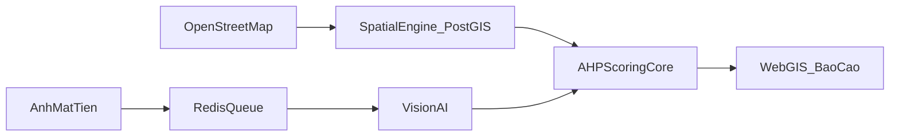

# Tổng quan dự án

Nền tảng web hỗ trợ đánh giá mức độ phù hợp của địa điểm kinh doanh tại nội thành Hà Nội. Hệ thống kết hợp phân tích không gian đa chiều (GIS) với trí tuệ nhân tạo đa phương thức để chấm điểm, so sánh và tư vấn mặt bằng theo từng ngành hàng.

Tài liệu này mô tả đề tài ở mức ổn định. Tiến độ triển khai và trạng thái duyệt nằm ở [TIEN-DO.md](TIEN-DO.md).

## Tên đề tài

**Tiếng Việt:** Xây dựng hệ thống hỗ trợ đánh giá mức độ phù hợp địa điểm kinh doanh dựa trên phân tích dữ liệu không gian đa chiều (GIS) kết hợp trí tuệ nhân tạo đa phương thức.

**Tiếng Anh:** Development of a Commercial Location Suitability Decision Support System Based on Multi-dimensional Spatial Analysis (GIS) and Multimodal Artificial Intelligence.

## Bài toán

Tại các thành phố lớn như Hà Nội, chọn mặt bằng (cửa hàng bán lẻ, dịch vụ ăn uống, nhà thuốc) quyết định sự sống còn của mô hình kinh doanh vừa và nhỏ. Khảo sát hiện nay phần lớn dựa trên kinh nghiệm cảm tính, thiếu số liệu về mật độ dân cư, hệ sinh thái tiện ích xung quanh, áp lực cạnh tranh trực tiếp và khả năng tiếp cận giao thông.

Bản đồ số thông thường chỉ hiển thị vị trí. Chúng chưa phân tích không gian theo từng loại hình kinh doanh, và cũng không phản ánh yếu tố vật lý tại thực địa: độ rộng vỉa hè, khả năng đỗ xe, vật cản che tầm nhìn mặt tiền.

Đề tài xây dựng một hệ hỗ trợ ra quyết định (Decision Support System). GIS xử lý dữ liệu không gian vĩ mô. AI đa phương thức thẩm định hiện trạng vật lý qua ảnh thực tế.

## Mục tiêu

**Mục tiêu tổng quát:** Thiết kế và xây dựng một nền tảng web để người dùng phân tích, chấm điểm mức độ phù hợp và so sánh tiềm năng các địa điểm kinh doanh theo từng ngành hàng tại khu vực đô thị.

**Mục tiêu cụ thể:**

1. Chuẩn hóa cơ sở dữ liệu không gian từ OpenStreetMap cho khu vực thực nghiệm tại Hà Nội. Tối ưu truy vấn vùng đệm và mạng lưới giao thông trên PostgreSQL/PostGIS.
2. Dùng phân tích thứ bậc (AHP) để xây dựng bộ tiêu chí và công thức chấm điểm đa chiều, kết hợp chỉ số hiệu quả chi phí theo giá thuê mặt bằng.
3. Tích hợp mô hình AI thị giác (Vision-Language Model) xử lý bất đồng bộ: trích xuất đặc trưng vật lý mặt tiền từ ảnh thực địa (sức chứa vỉa hè, tầm nhìn, hạ tầng xung quanh) và sinh báo cáo tư vấn.
4. Xây dựng bản đồ tương tác: phân tích vùng ảnh hưởng, bản đồ nhiệt, so sánh nhiều địa điểm và xuất báo cáo thẩm định.

## Phạm vi

**Không gian:** Các quận nội thành Hà Nội có độ phủ điểm tiện ích cao và hoạt động thương mại sôi động: Cầu Giấy, Bắc Từ Liêm, Đống Đa, Thanh Xuân.

**Nghiệp vụ:** Ba nhóm bán lẻ / dịch vụ có đặc thù không gian khác nhau:

- Quán cà phê / đồ uống
- Nhà thuốc
- Cửa hàng tiện lợi

**Kỹ thuật:** Đánh giá hai giai đoạn để cân bằng hiệu năng và chi phí vận hành.

- Giai đoạn 1 chạy trên dữ liệu bản đồ: mật độ điểm hút khách, mức bão hòa đối thủ, tiếp cận trục đường, rồi chấm điểm AHP. Bước này lọc và xếp hạng địa điểm với chi phí tính toán thấp.
- Giai đoạn 2 chỉ chạy khi cần thẩm định sâu: ảnh mặt tiền đi vào hàng đợi, mô hình thị giác trả về đặc trưng có cấu trúc, rồi được đưa vào báo cáo và điểm tổng hợp.

## Bốn phân hệ

### 1. Quản lý và xử lý dữ liệu không gian (Spatial Engine)

- Tiền xử lý và nạp dữ liệu bản đồ `.osm.pbf` vào PostgreSQL/PostGIS. Cách làm của hạng mục này nằm ở [DU-LIEU.md](DU-LIEU.md).
- Đánh chỉ mục không gian GIST.
- Cache không gian trên Redis.
- Truy vấn đa vùng đệm 200 m, 500 m và 1000 m: mật độ điểm hút khách, mức độ bão hòa đối thủ, khoảng cách tới trục đường chính.
- Người dùng đóng góp điểm tiện ích mới phát hiện ngoài thực địa; dữ liệu đóng góp phải qua kiểm duyệt trước khi đưa vào tính điểm.

Đối tượng dữ liệu: điểm tiện ích (trường học, văn phòng, chung cư, bệnh viện, trạm giao thông công cộng), mạng lưới đường bộ, và các cơ sở kinh doanh cùng ngành.

### 2. Lõi chấm điểm đa tiêu chí (AHP Scoring Core)

- Ma trận so sánh cặp chuẩn AHP cho từng loại hình kinh doanh.
- Tỷ số nhất quán CR nhỏ hơn 0.1.
- Chuẩn hóa các chỉ số không gian về thang điểm từ 0 đến 100.
- Tham số giá thuê dự kiến để tính chỉ số hiệu quả đầu tư (ROI Index). Bản đang chạy chưa có doanh thu nên chưa tính ROI. Chỉ số hiện có là điểm không gian trên mỗi triệu đồng tiền thuê một tháng, ghi ở [CHAM-DIEM.md](CHAM-DIEM.md).

Trọng số tiêu chí theo quy trình phân tích thứ bậc của Thomas L. Saaty, tách riêng cho cà phê / đồ uống, nhà thuốc và cửa hàng tiện lợi vì mỗi ngành ưu tiên không gian khác nhau.

### 3. Thẩm định hình ảnh và tư vấn AI (Multimodal AI Pipeline)

- Hàng đợi bất đồng bộ trên Redis.
- WebSocket (STOMP) cập nhật trạng thái xử lý theo thời gian thực.
- Tầng 1 chạy trên máy: YOLOv8m đa tỷ lệ (COCO), YOLOv8s-Worldv2, SegFormer-B0 Cityscapes và Depth-Anything-V2-Small đếm người đi bộ (tách riêng người lái xe hai bánh), xe máy, ô tô (gộp car, bus, truck có khử trùng liên lớp), cây, cột điện và biển báo đứng chắn trước nền mặt tiền. Mô hình bề rộng chỉ chạy khi kiểm định cảnh xác nhận mặt tiền tầng trệt và vỉa hè lộ rõ (loại trừ gầm cầu cạn, mặt nền bị xe che khuất và ảnh nhân tạo).
- Tầng 2 đối chiếu số đếm, kiểm định cảnh mặt tiền và chỉ số PostGIS thành câu tư vấn trung thực. API đám mây chưa được gắn. Ảnh không được gửi đi.

Đầu vào tầng 1 hỗ trợ JPEG, PNG và WebP. Biển báo chắn tầm nhìn kiểm tra đồng thời nền công trình phía sau (SegFormer) và độ sâu đứng trước mặt công trình (Depth-Anything-V2).

### 4. Trực quan hóa bản đồ và báo cáo (Web GIS và Analytics)

- Bản đồ tương tác OpenLayers: vùng bán kính, phân loại đối thủ và khách hàng tiềm năng, lớp bản đồ nhiệt.
- So sánh đối đầu 2–3 mặt bằng bằng biểu đồ mạng nhện (radar).
- Xuất báo cáo thẩm định dạng PDF.

## Công nghệ

| Lớp | Lựa chọn |
| --- | --- |
| Ngôn ngữ và backend | Java 17+, Spring Boot (modular monolith), Spring Security, Spring Data JPA |
| Cơ sở dữ liệu và bản đồ | PostgreSQL, PostGIS, OpenLayers, OpenStreetMap (Geofabrik) |
| Bất đồng bộ và cache | Redis (hàng đợi và spatial cache), WebSocket STOMP |
| Trí tuệ nhân tạo | YOLOv8m đa tỷ lệ, YOLOv8-World, SegFormer Cityscapes và Depth-Anything-V2 cho số đếm và kiểm định cảnh; mô hình bề rộng cho mét vỉa hè. Câu tư vấn đối chiếu từ JSON. API đám mây chưa gắn |
| Frontend | React, Tailwind CSS, Chart.js |

## Cách kiểm chứng

Dữ liệu bản đồ mở được làm sạch và phân loại theo thẻ OSM vào các bảng không gian.

Kiểm chứng ngược (back-testing): thu thập tọa độ và ảnh thực tế của 10–15 địa điểm kinh doanh tại Hà Nội, gồm nhóm cửa hàng hoạt động ổn định lâu năm và nhóm cửa hàng đã dừng hoạt động hoặc sang nhượng. Điểm của hệ thống được đối chiếu với thực trạng vận hành ngoài đời.

## Trạng thái kho mã

Tám hạng mục đầu đã được ba giám khảo chấm đạt mức yêu cầu và ghi `thành công` trong [TIEN-DO.md](TIEN-DO.md). Hạng mục kiểm chứng vẫn `chờ duyệt`. Đóng góp điểm tiện ích có người duyệt khác người gửi, bằng một mã dùng chung chứ chưa phải tài khoản từng người. Kiểm chứng đã chấm mọi cơ sở có tên, đã loại node biến mất vì dọn dữ liệu Grab hoặc đổi tên WinMart, và có 10 điểm có nguồn: 5 Circle K còn trong danh sách hãng ở cả hai mốc, 5 điểm người vẽ ghi không còn. Circle K số 74 Nguyễn Khang có bài báo về việc ngừng hoạt động ngày 19/6/2024. Số 74 chưa được vẽ, nên điểm được nội suy giữa số 78 và số 80 trên cùng phố. Mẫu đã chấm là 11 điểm, không phải khảo sát 15 cửa hàng đã đóng tại chỗ. CafeBiz ngày 19/5/2025 ghi chuỗi Nhà thuốc An Khang không còn cửa hàng tại Hà Nội. Bài không có số nhà và bản đồ không có node thương hiệu này trong bốn quận, nên dòng đó không có điểm. Đã có 154 cơ sở có thương hiệu và số nhà để làm mốc. Ảnh đọc được đi qua YOLOv8m, YOLO-World, SegFormer và Depth-Anything trên máy này, rồi mới tới ước lượng bề rộng khi cảnh mặt tiền đạt. Tầm nhìn vẫn để trống nên chưa trộn vào điểm ngành. API đám mây chưa được gắn và không nhận ảnh. Công thức và số đã đo nằm ở [CHAM-DIEM.md](CHAM-DIEM.md). Bản đồ, so sánh 2–3 mặt bằng, PDF và nút kiểm chứng đã có ở trang `/`. Mô hình bề rộng học trên 514 số đo tại Seoul. Sai số kiểm tra của k = 7 là 0,618 m. Ảnh kém không được gán bề rộng. Số mét được gắn vào kết quả của cả ba ngành nhưng không trộn vào điểm tổng.

Khi một hạng mục được triển khai, trạng thái trong [TIEN-DO.md](TIEN-DO.md) chuyển thành `chờ duyệt`. Hạng mục chỉ thành `thành công` sau khi người phụ trách xác nhận đã xem và chức năng ổn.
